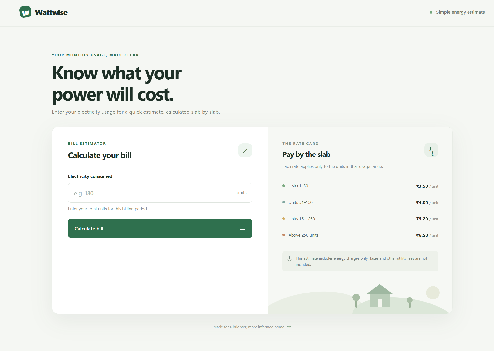

# Electricity Bill Calculator

A small Java web app for estimating an electricity bill from the number of units used. Enter your usage to see the total and how it is split across the rate slabs.

## Rate slabs

| Units | Rate |
| --- | ---: |
| 1–50 | ₹3.50 per unit |
| 51–150 | ₹4.00 per unit |
| 151–250 | ₹5.20 per unit |
| Above 250 | ₹6.50 per unit |

The rates are progressive: each price applies only to the units in that range. The estimate covers energy charges only, not taxes or other utility fees.

## Screenshots




## Run locally

You’ll need Java 17, Maven, and a Jakarta-compatible servlet container such as Tomcat 10.1.

Build and run the tests:

```sh
mvn test package
```

Deploy `target/electricity-bill.war` to Tomcat, then open:

```text
http://localhost:8080/electricity-bill/bill
```
